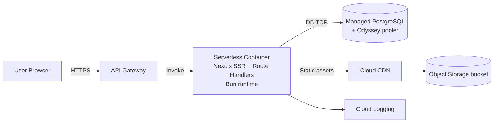

## Executive Summary

This guide documents how to migrate a production **Bun + Next.js 16** app (App Router, SSR, route handlers/API routes) from **Vercel** to **Yandex Cloud** with two viable target architectures:

- **Serverless-first** using **Yandex Serverless Containers** (preferred when constraints fit).
- **Compute VM (VPS-like)** using **Yandex Compute Cloud**, with a recommended path toward **Instance Groups + Application Load Balancer** for production-grade HA.

Key conclusions from the available platform constraints:

- **Bun can run in Yandex Serverless Containers** because it runs an arbitrary container image; the runtime environment is Linux (Ubuntu 22.04 LTS) on **AMD64**, and compatible container image formats include **Docker Image Manifest V2** and **OCI**. citeturn5view1turn0search17
- **Bun is not a first-class runtime in Yandex Cloud Functions** (Cloud Functions provides specific managed runtimes and does not list Bun), so “serverless Bun” is realistically **Serverless Containers**, not Functions. citeturn3search0turn5view1
- The **hard request/response size limit (3.5 MB)** and the **header constraints for direct container invocation** require careful validation for a browser-facing Next.js SSR site (especially if you rely on cookie-based auth, streaming responses, or WebSockets). citeturn0view0turn12view0
- If your app needs **cookie-based SSR sessions**, **WebSockets with long-lived backend state**, **large uploads**, or **beyond-3.5MB responses**, the **Compute VM** approach is usually the safer default.

Region/compliance note: Yandex Cloud’s RU region (ru-central1) provides multiple availability zones such as `ru-central1-a`, `ru-central1-b`, `ru-central1-d` (recommended for new projects), and `ru-central1-m`. citeturn17search0 Yandex Cloud also publishes compliance materials related to Russia’s personal data law (152‑FZ). citeturn17search22turn17search32

## Architecture Options

### Option 1: Yandex Serverless Containers (recommended when feasible)

**When it fits best**

Choose this when your app is a good match for the platform’s serverless constraints:

- Stateless SSR/API workload with responses and uploads comfortably within **3.5 MB** per request/response. citeturn0view0
- No strict requirement for direct **HTTP upgrade** style protocols on the app container entrypoint (direct invocation removes the `Upgrade` header and disallows `Transfer-Encoding` in responses). citeturn12view0
- You benefit from scaling-to-zero and you can set concurrency and instance limits to protect your database. citeturn2search4turn2search23

**Core building blocks**

- **Container Registry** to store your Docker images (Serverless Containers can only deploy images stored in Yandex Container Registry). citeturn24search3
- **Serverless Containers**: revisions; one “active revision” receives traffic; new revisions become active by default; rollback is supported by switching back to an earlier revision. citeturn24search3turn19search13
- **API Gateway** for a stable HTTPS endpoint, custom domains + TLS, and (optionally) WebSocket gateway patterns. citeturn9search5turn1search28turn10view0
- **Lockbox** for secrets (either injected into the container revision or pulled via API using a service account token). Transmitting secrets to a container can be done as “deliver Lockbox secrets,” is marked **Preview**, is cached for up to **5 minutes**, and creates a new revision when applied. citeturn0view2
- **VPC networking**: Serverless Containers can run in a user VPC network (with constraints) or in an isolated NAT-backed network by default. citeturn26view0turn25search4

### Option 2: Yandex Compute VM (fallback)

This is the “known-good” approach for almost any Next.js shape because you control the full HTTP stack (cookies, WebSockets, streaming, upload sizes) and you can tune system-level settings.

**Two VM flavors**

- **Single VM + reverse proxy** (fastest to ship; simplest). Use a reserved public IP and Nginx/Caddy in front of your Bun/Next runtime.
- **Managed Instance Group + Application Load Balancer** (recommended for production availability). Yandex recommends distributing across zones and can integrate instance groups with **Network Load Balancer** or **Application Load Balancer**. citeturn8search15turn8search19turn17search13

**Load balancer choice**

- Use **Application Load Balancer** (L7) to terminate TLS and route HTTP/HTTPS traffic to backends. citeturn8search19turn8search11

### Optional: Managed Kubernetes (only if clearly justified)

Consider **Managed Service for Kubernetes** if you need:

- Multiple services, background workers, and higher-level traffic management (traffic splitting, service mesh), or
- Tight control over rollout patterns beyond “switch active revision” (Serverless Containers) and beyond “roll instance group” (VM).

Yandex Cloud supports Kubernetes networking concepts like Gateway API that can provision an Application Load Balancer from cluster configuration. citeturn20search33  
This adds operational complexity, so it is usually not the first stop for a single Next.js app unless your organization is already standardized on Kubernetes.

## Compatibility & Constraints

### Bun support status (what is supported, what isn’t, and workarounds)

**Serverless Containers**

- Serverless Containers runs arbitrary container images and documents that the runtime environment is **Ubuntu 22.04 LTS** and **AMD64**, and supports standard container formats (Docker v2, OCI). citeturn5view1turn0search17
- This makes Bun feasible **as long as your image contains a Linux x86_64 Bun binary** (the standard Bun Docker images do).
- CPU resources are billed/allocated based on configuration, with a documented maximum of **4 vCPU**, and CPU is provided during request processing. citeturn0search16

**Cloud Functions**

- Cloud Functions lists supported managed runtimes (e.g., Node.js, Python, Go, Java, .NET, etc.) and does not list Bun; therefore Bun isn’t a first-class Functions runtime choice. citeturn3search0

**Least-painful alternative if Bun is problematic**

- Run **Next.js under Node.js** in production on Yandex Cloud and keep Bun for local tooling. This preserves compatibility with Next’s official “self-hosting” expectations while still letting you use Bun locally where it adds value.
- This alternative is particularly attractive if you hit an edge-case in Bun’s Node API compatibility for Next.js 16 SSR.

### Next.js 16 SSR/API route support details

- Next.js provides explicit **self-hosting guidance**, including the ability to host static assets separately via `assetPrefix`. citeturn8search32
- If you use `output: "standalone"`, Next.js produces a standalone server bundle; the Next.js docs describe `output` configuration and note constraints around custom servers in this mode. citeturn4search2turn4search6
- Next.js image optimization works self-hosted “with zero configuration” when deploying with `next start`, but you may need to install `sharp` (and in `output: "standalone"` mode, `sharp` is required for production optimization). citeturn9search13turn9search6
- Bun’s official Next.js guide states Bun “can run Next.js development and production servers” and recommends prefixing Next CLI commands with `bun --bun` in scripts. citeturn23view0

### DB connection + pooling considerations

**Serverless scaling and connection storms**

- Serverless Containers can scale concurrency per instance. A common risk is each new instance establishing its own DB connections (“connection storm”).
- Yandex Managed Service for PostgreSQL includes a built-in pooler based on **Odyssey**, and documents pooling modes such as **transaction pooling** and **statement pooling**, with key caveats (e.g., prepared statements not supported in transaction pooling). citeturn0view3
- Use Serverless Containers concurrency controls (1–16) and zone instance/request limits to constrain DB connection growth. citeturn2search4turn2search23

**VM approach**

- On VMs you can keep a stable pool (e.g., PgBouncer/Odyssey, ORM pool, etc.) and tune max connections and keepalive behavior more predictably.

## Decision Framework

### Decision Matrix (Table)

| Dimension                 | Serverless Containers                                                                                                                                                    | Compute VM (single VM or Instance Group)                                                                          |
| ------------------------- | ------------------------------------------------------------------------------------------------------------------------------------------------------------------------ | ----------------------------------------------------------------------------------------------------------------- |
| Bun compatibility         | High: any container image on Ubuntu 22.04 AMD64 runtime citeturn5view1                                                                                                | High: full OS control                                                                                             |
| Next.js SSR compatibility | Possible, but must validate request/response size and header behavior; default timeouts/concurrency need tuning citeturn0view0turn2search4turn12view0               | High: standard self-hosting environment with full HTTP semantics                                                  |
| Hard payload limits       | 3.5 MB request and response (incl. headers) citeturn0view0turn16search1                                                                                              | Depends on your reverse proxy and app; typically far higher                                                       |
| Concurrency control       | Configurable concurrency (1–16 per instance) citeturn2search4                                                                                                         | Controlled by instance sizing and app server; can be easier to model                                              |
| Cold start mitigation     | Provisioned instances are supported (keep instances ready) citeturn2search7                                                                                           | No cold starts; but you pay for idle capacity                                                                     |
| Timeouts                  | Default request execution timeout can be low (example default 3s); can be increased, incl. long-lived containers >10 min with cautions citeturn2search4turn19search2 | Fully controlled by your stack (ALB/Nginx/app)                                                                    |
| Networking                | Outbound connections supported; inbound to container instance IP not supported; can attach to VPC with conditions citeturn26view0                                     | Full VPC control; inbound via LB/public IP; outbound via NAT or public IP                                         |
| Secrets                   | Lockbox delivery to containers (Preview, cached) or fetch via API using IAM token from metadata citeturn0view2turn7search6turn7search1                              | Lockbox usable via CLI/API; can pull in cloud-init; more flexibility citeturn7search0turn7search15            |
| Observability             | Logs can be routed to Cloud Logging log groups via log options citeturn6search27                                                                                      | VM agent-based monitoring/logging; Yandex suggests using Unified Agent with monitoring roles citeturn7search15 |
| Rollbacks                 | Switch active revision / rollback to older revision supported citeturn24search3turn19search13                                                                        | Rollback by redeploy, image tag rollbacks, or instance group rolling recreate/redeploy                            |
| Operational burden        | Lower: no VM patching; but must design around platform constraints and test edge cases                                                                                   | Higher: patching/hardening/load balancers; but fewer “serverless edge cases”                                      |

### Reference Architecture Diagrams

#### Serverless-first



Relevant platform notes:

- A Serverless Container can be invoked over HTTPS and via API Gateway extension. citeturn9search5turn15view0
- Default isolated networking uses NAT; attaching to a user network is supported with documented conditions and still only supports outbound connections from the container instance. citeturn26view0

#### VM-based

```mermaid
flowchart LR
  U[User Browser] -->|HTTPS| ALB[Application Load Balancer<br/>(TLS termination)]
  ALB --> IG[Instance Group (multi-zone) <br/>VMs running Docker: Next.js + Bun]
  IG --> PG[(Managed PostgreSQL<br/>+ Odyssey / pooling)]
  IG --> OS[(Object Storage)] --> CDN[Cloud CDN]
  IG --> LOG[VM logs/metrics via agent]
```

- Application Load Balancer is an L7 service that terminates TLS and routes HTTP/HTTPS traffic. citeturn8search19turn8search11
- Instance groups integrate with load balancers and automatically build target groups. citeturn8search15

## Migration Plan

### Pre-migration checklist

1. **Inventory Vercel features you rely on**, especially:
   - Edge caching / ISR behavior and whether you rely on any edge-only APIs.
   - Image optimization behavior, including `next/image` usage.
   - Cookie-based auth (NextAuth, custom cookies), streaming SSR, WebSockets/SSE.
2. **Confirm app constraints against Serverless Container hard limits**:
   - 3.5 MB max request size and 3.5 MB max response size. citeturn0view0turn16search1
   - Any large uploads/downloads or large rendered payloads likely push you to the VM approach.
3. Decide where secrets live:
   - Lockbox delivery into Serverless Containers revision (Preview, cached). citeturn0view2
   - Or fetch Lockbox payload at runtime via API (`Payload.Get`) using a service account IAM token. citeturn7search1turn7search6
4. Choose a region/zone strategy:
   - If RU-centric, plan for `ru-central1-*` availability zones; `ru-central1-d` is recommended for new projects. citeturn17search0

### Containerization (Dockerfile examples)

The goals:

- Produce a small, reproducible container image.
- Use Next’s self-hosting patterns.
- Keep runtime consistent between Serverless Containers and VM deployments.

#### Recommended Next.js production settings

In `next.config.js`:

```js
/** @type {import('next').NextConfig} */
const nextConfig = {
  output: 'standalone',
  // If you later put static assets on Object Storage + CDN:
  // assetPrefix: process.env.ASSET_PREFIX,
};
module.exports = nextConfig;
```

`output: "standalone"` is the documented mechanism for producing a standalone server bundle for deployment. citeturn4search2  
If you rely on Image Optimization in standalone mode, install `sharp`. citeturn9search6

#### Dockerfile (Bun runtime)

```dockerfile
# syntax=docker/dockerfile:1

FROM oven/bun:1 AS deps
WORKDIR /app

# Install dependencies
COPY package.json bun.lockb ./
RUN bun install --frozen-lockfile

FROM oven/bun:1 AS builder
WORKDIR /app
ENV NODE_ENV=production

COPY --from=deps /app/node_modules ./node_modules
COPY . .

# Build Next.js with Bun runtime executing Next CLI
RUN bun --bun next build

# --- runtime image ---
FROM oven/bun:1 AS runner
WORKDIR /app
ENV NODE_ENV=production

# Next.js standalone output
COPY --from=builder /app/.next/standalone ./
COPY --from=builder /app/.next/static ./.next/static
COPY --from=builder /app/public ./public

# Serverless Containers sets $PORT; default to 3000 locally
ENV PORT=3000
EXPOSE 3000

# server.js is produced by Next standalone output
CMD ["bun", "server.js"]
```

Notes you must validate:

- Bun’s official Next.js guide states Bun can run Next.js development and production servers and recommends `bun --bun next ...` scripts. citeturn23view0
- Serverless Containers requires your application to listen on the `PORT` environment variable provided by the platform. citeturn3search17
- If you see missing image optimization in production, install `sharp` (`bun add sharp`) as per Next’s documented guidance. citeturn9search6

#### Dockerfile fallback (Node runtime, Bun for install/build)

If you want to reduce risk, run Node in production:

```dockerfile
# syntax=docker/dockerfile:1

FROM oven/bun:1 AS deps
WORKDIR /app
COPY package.json bun.lockb ./
RUN bun install --frozen-lockfile

FROM oven/bun:1 AS builder
WORKDIR /app
COPY --from=deps /app/node_modules ./node_modules
COPY . .
RUN bun --bun next build

FROM node:20-bookworm-slim AS runner
WORKDIR /app
ENV NODE_ENV=production

COPY --from=builder /app/.next/standalone ./
COPY --from=builder /app/.next/static ./.next/static
COPY --from=builder /app/public ./public

ENV PORT=3000
EXPOSE 3000
CMD ["node", "server.js"]
```

This aligns runtime expectations with Next’s Node-first ecosystem while retaining Bun’s speed for install/build.

### Infrastructure setup (Yandex Cloud resources)

This section covers the shared setup steps you will reuse in both architectures.

#### Install and initialize Yandex Cloud CLI

Yandex documents CLI installation and initialization (`yc init`). citeturn7search3turn7search7

#### Resource layout recommendation

Use separate folders so IAM boundaries cleanly map to environments. Yandex Cloud resources live inside folders; folders belong to a cloud; clouds belong to an organization. citeturn17search2turn17search3

Example:

- `infra` folder: Container Registry, shared DNS/CDN assets
- `prod` folder: Serverless Container / VMs, API Gateway, DB, Lockbox
- `stage` folder: same shape as prod

#### Create Container Registry and push your image

1. Create a registry (see Container Registry quickstart). citeturn24search0
2. Configure Docker to use Yandex’s credential helper: citeturn24search1
3. Authenticate and push:
   - Container Registry documents authentication methods (OAuth token, IAM token up to 12 hours, or credential helper). citeturn24search2
   - Pushing images requires the `container-registry.images.pusher` role or higher. citeturn24search4turn20search35

#### Secrets with Lockbox (shared concept)

- `yc lockbox payload get` is the documented CLI command to retrieve a secret payload. citeturn7search0
- Lockbox API also supports reading payloads via REST (`Payload.Get`). citeturn7search1

### Deployment steps (serverless + VM)

#### Serverless Containers deployment

1. **Create a service account** for deployment automation (CI/CD).  
   Yandex’s official CI/CD tutorial for Serverless Containers uses roles including:
   - `container-registry.images.pusher`
   - `serverless-containers.editor`
   - `iam.serviceAccounts.user` citeturn18search0

2. **Create the Serverless Container** and deploy a revision from your image.
   - Serverless Containers can only create revisions from images in Yandex Container Registry. citeturn24search3
   - Revision deploy is done via `yc serverless container revision deploy`. citeturn25search0
   - Concurrency can be configured and is constrained to 1–16. citeturn2search4

3. **Configure VPC networking if you need private DB access**:
   - By default, containers run in an isolated IPv4 network with NAT (public IPv4 reachable). citeturn26view0
   - If you specify a user network, the network must have subnets in all availability zones and at least one resource with an IP in that network; otherwise operation is not guaranteed. citeturn26view0turn25search4
   - When attached, a “service subnet” from `198.19.0.0/16` is created per zone; containers get an IP in that subnet; only **outbound** connectivity is supported. citeturn26view0

4. **Expose the app with API Gateway**:
   - A container can be invoked via API Gateway integration. citeturn15view0turn9search5
   - Add a custom domain using `yc serverless api-gateway add-domain`. citeturn1search28

5. **Tune runtime settings**:
   - Default container execution timeout may be low (example defaults show 3s); tune for SSR. citeturn2search4
   - Consider provisioned instances to reduce cold starts. citeturn2search7
   - Enforce concurrency and zone instance limits to protect DB connections. citeturn2search4turn2search23

6. **Validate header compatibility** before production cutover:
   - For direct HTTPS invocation of a container, Yandex documents removal of headers like `Cookie` and `Upgrade`, and disallows `Transfer-Encoding` in responses (error if present). This is critical to test against Next.js SSR/auth behavior. citeturn12view0turn16search2

#### Compute VM deployment

Two implementation levels are included; pick one.

##### Level one: single VM (fastest migration)

1. Create a VM with `cloud-init` to install Docker and run your image. Yandex documents creating a VM using custom configuration scripts and `cloud-init`. citeturn7search15
2. Pull your image from Container Registry:
   - Container Registry authentication via IAM token is supported and IAM tokens also authenticate Docker clients. citeturn24search5turn24search2
3. Put **Nginx** or **Caddy** in front for TLS termination and gzip/brotli, or terminate TLS at Application Load Balancer and run plain HTTP on the VM.

##### Level two: Instance Group + Application Load Balancer (production-grade)

1. Create a multi-zone design (or multiple zonal instance groups). Yandex recommends using multiple zonal instance groups distributed across availability zones rather than a single multi-zonal group for more granular control. citeturn17search13
2. Integrate the instance group with a load balancer:
   - Yandex supports integrating instance groups with both Network Load Balancer and Application Load Balancer. citeturn8search15
3. Configure **Application Load Balancer**:
   - It terminates TLS and routes HTTP/HTTPS requests. citeturn8search19turn8search11

### Secrets & IAM

#### Serverless Containers IAM essentials

- Access management is role-based. To deploy/invoke/manage containers, use service roles (`serverless-containers.editor`, `serverless-containers.admin`, etc.). citeturn21view0
- If you make a container public, you grant the `serverless-containers.containerInvoker` role to `allUsers`. citeturn20search0turn21view0
- For private containers invoked by API Gateway, the integration requires an invoking service account with `serverless-containers.containerInvoker` per API Gateway docs. citeturn15view0

#### Lockbox patterns

- **Inject into revision** (convenient, but environment-variable size constrained; secrets delivered to a container are cached for up to 5 minutes and are Preview). citeturn0view2turn0view0
- **Fetch runtime payload** (more flexible): obtain an IAM token from the metadata service if you attach a service account to your revision, then call Lockbox `Payload.Get`. citeturn7search6turn7search1

### Networking (VPC, security groups, egress)

#### Serverless Containers networking rules to internalize

- Default networking uses NAT; only public IPv4 is reachable without attaching to a user VPC. citeturn26view0
- User VPC attach requires subnets in all zones + at least one resource with an IP in the network; service subnets are created under `198.19.0.0/16`. citeturn26view0turn25search4
- Only outbound connections are supported from container instances; inbound to the container instance IP is not supported. citeturn26view0turn22search1

#### Security groups

- Yandex VPC security groups are the native firewall mechanism; reference rules can help keep access rules consistent under autoscaling (example shows an instance group + managed PostgreSQL pattern). citeturn22search0
- Security group rules have documented hard limits (e.g., max rules per group). citeturn3search2

#### Egress IP allowlisting caveat

- Yandex VPC NAT gateway uses a random public IP from a specific range and that IP cannot be whitelisted. citeturn3search23  
  If your external database/vendor requires strict IP allowlists, plan for a design that provides stable egress (often via a VM-based NAT/proxy pattern).

### DB connectivity (private/public, TLS, pooling)

#### Managed PostgreSQL + pooling

- Managed Service for PostgreSQL is documented as a managed cluster service. citeturn22search17
- The built-in pooler uses Odyssey and supports transaction pooling and statement pooling with documented trade-offs (e.g., prepared statements not supported in transaction pooling). citeturn0view3

#### Serverless Containers DB best practices

1. Set **container concurrency** so that DB connections per instance remain bounded (1–16). citeturn2search4
2. Use **Odyssey** on Managed PostgreSQL where feasible. citeturn0view3
3. Use zone/instance limits in scaling settings as a “circuit breaker” to protect DB capacity. citeturn2search23

### Static assets + CDN (if needed)

There are two common patterns:

1. **Serve assets from the app container / VM** (simplest; okay for small/medium traffic).
2. **Offload static assets to Object Storage + Cloud CDN**:
   - Object Storage supports static website hosting. citeturn8search0turn8search20
   - Cloud CDN can use an Object Storage bucket as an origin, and the quickstart notes the primary domain can’t be changed after creating a CDN resource. citeturn8search1turn8search5
   - Next.js supports `assetPrefix` to host static assets on a separate domain/CDN. citeturn8search32

For `next/image`:

- Self-hosted image optimization works with `next start`, but production optimization commonly depends on `sharp` (and is required for standalone output). citeturn9search13turn9search6

## CI/CD

### Example GitHub Actions workflows

entity["company","GitHub","code hosting platform"] Actions can do both “build+push image” and “deploy”.

#### Serverless Containers CI/CD outline (build, push, deploy)

Yandex’s official tutorial for deploying to Serverless Containers using GitHub Actions (via SourceCraft integration) lists the required roles and demonstrates a workflow shape: authenticate, push to Container Registry, and deploy a container revision. citeturn18search0turn25search10

A generic repo-driven workflow (conceptual) usually needs:

- Service account key (or federation) to authenticate `yc`
- Build image
- `yc container registry configure-docker`
- `docker push`
- `yc serverless container revision deploy ...`

Also note:

- Authentication methods for Container Registry are documented (IAM token, OAuth token, credential helper). citeturn24search2turn24search1

### Rollback strategy

#### Serverless Containers rollback

- New revisions become active by default, but you can switch the active revision back to an earlier one. citeturn24search3turn19search0
- The platform exposes a `rollback` API that rolls a container back to a specified revision. citeturn19search13

#### VM rollback

- If you deploy via immutable image tags, rollback is generally “redeploy previous tag” (single VM) or “roll instance group back to the previous template/image tag.”

## Observability, Operations, and Risk Controls

### Observability & Operations

**Serverless Containers**

- Logging destination is configurable via log options (log group or folder default). citeturn6search27
- Be cautious with long-lived requests; Yandex recommends asynchronous invocation for long-lived containers and warns about possible forced termination before timeout. citeturn19search2

**VM-based**

- Yandex documents using initialization (`cloud-init`) patterns and notes that installing Unified Agent and linking it to a service account with monitoring permissions is a supported setup approach. citeturn7search15

### Risk controls for Serverless Containers with Next.js

Treat the following as **mandatory pre-prod validation items**:

- **Cookie/session behavior**: direct invocation removes `Cookie` header; if your auth depends on cookies, verify whether your chosen ingress path (API Gateway integration vs direct invoke) preserves required headers end-to-end. citeturn12view0turn15view0
- **Streaming behavior**: responses containing `Transfer-Encoding` cause an error (direct invocation behavior). Next.js streaming SSR or streaming route handlers may be affected; test your exact app routes. citeturn12view0turn16search2
- **Payload sizes** near 3.5 MB (uploads, SSR payloads, JSON responses). citeturn0view0turn16search1

### Performance & Cost

**How to measure**

1. Capture baseline metrics on Vercel: TTFB, p95 latency, error rate, CPU time, DB query times.
2. On Yandex:
   - For Serverless Containers: compare “cold vs warm” behavior and consider provisioned instances. citeturn2search7
   - For VM/ALB: measure p95 under load and ensure instance group scaling rules are correct.

**Expected cost drivers**

- **Serverless Containers**:
  - Container invocations and allocated compute, plus outgoing traffic (pricing specifics depend on current SKU). (This is called out in Yandex’s CI/CD tutorial as the cost components.) citeturn18search0
  - Provisioned instances reduce cold starts but increase “always-on” cost. citeturn2search7

- **VM**:
  - Pay for allocated VM resources continuously; add ALB cost and bandwidth.
  - You manage capacity planning (or autoscaling via instance groups). citeturn8search15turn8search19

## Common Pitfalls & Troubleshooting

1. **Next.js app exceeds 3.5 MB request/response** → Serverless Containers will not fit for those endpoints. citeturn0view0turn16search1
2. **Auth breaks due to header behavior**:
   - Direct container invocation removes `Cookie` and `Authorization` headers. citeturn12view0
   - Plan ingress so auth metadata reaches your app (often via API Gateway authorizers or token-in-header patterns).
3. **Streaming/WebSockets expectations mismatch**:
   - `Transfer-Encoding` in responses is disallowed (direct invocation), and `Upgrade` is removed. citeturn12view0
   - If you need WebSockets at the edge, API Gateway provides WebSocket protocol support (Preview) with constraints: message size up to 128 KB, frame size 32 KB, idle timeout 10 minutes, maximum lifetime 60 minutes. citeturn10view0
4. **Database connection exhaustion under serverless scale**:
   - Use concurrency controls (1–16), scaling limits, and PostgreSQL pooling (Odyssey). citeturn2search4turn2search23turn0view3
5. **NAT allowlisting misconceptions**:
   - NAT gateway uses random public IP from a range and can’t be allowlisted. citeturn3search23

## Appendix

### Hard limits and “must know” constraints (Serverless Containers)

- Max container image size: **10 GB** citeturn0view0
- Max RAM per instance: **8 GB** citeturn0view0
- Max ephemeral disk per instance: **10 GB** citeturn0view0
- Max HTTP request size: **3.5 MB** (headers + body) citeturn0view0turn16search1
- Max HTTP response size: **3.5 MB** (headers + body) citeturn0view0turn16search1
- Concurrency: **1–16 per instance** citeturn2search4
- Runtime environment: **Ubuntu 22.04 LTS**, **AMD64** citeturn5view1
- Direct invocation header constraints: `Cookie` removed from requests; `Transfer-Encoding` in responses causes an error; `Upgrade` removed. citeturn12view0turn16search2

### “Copy/paste” commands you will likely use

```bash
# Install yc CLI (Linux/macOS typical)
curl -sSL https://storage.yandexcloud.net/yandexcloud-yc/install.sh | bash

# Initialize profile
yc init

# Configure docker credential helper for Container Registry
yc container registry configure-docker
```

CLI install/init and registry helper commands are documented by Yandex. citeturn7search11turn7search7turn24search1

### Where to look in Yandex docs when you start implementing

- Serverless Containers limits citeturn0view0
- Serverless Containers networking citeturn26view0
- Container header constraints for invocation citeturn12view0
- Container Registry auth + push citeturn24search2turn24search4
- Lockbox payload retrieval citeturn7search0turn7search1
- Managed PostgreSQL pooling (Odyssey) citeturn0view3
- Application Load Balancer concepts/quickstart citeturn8search19turn8search11
